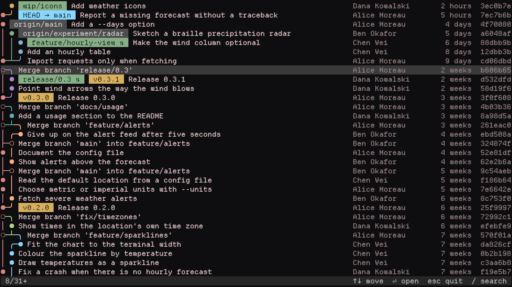
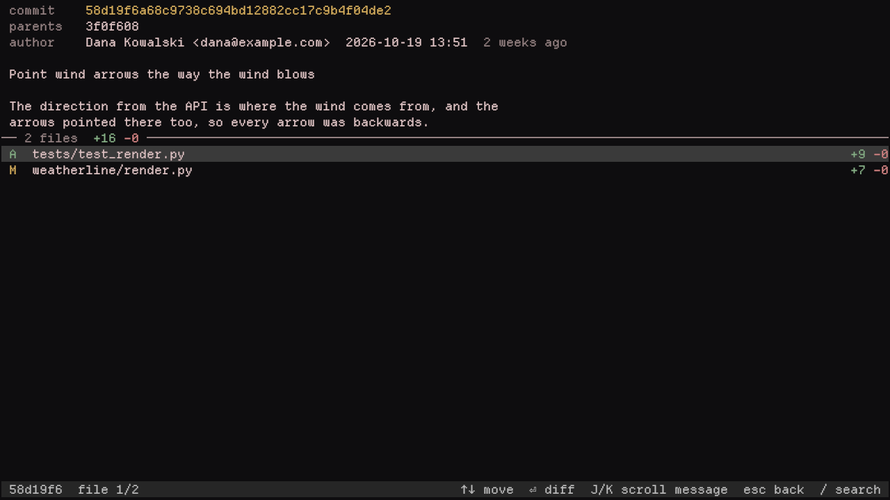
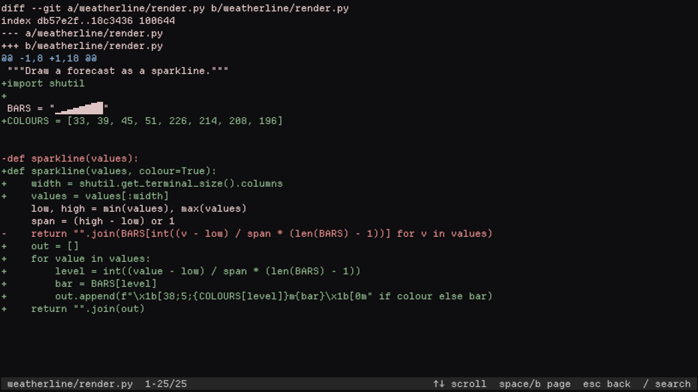
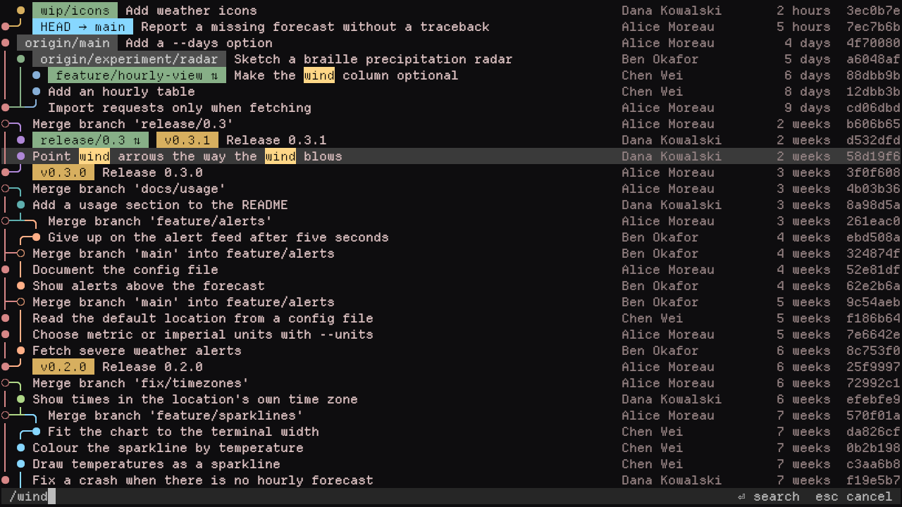

# git-tree

`git tree` draws the commit graph of every branch, remote branch and tag in
the terminal, laid out like the revision grid of
[Git Extensions](https://gitextensions.github.io/), and lets you step through
it: open a commit to read its full message and the files it changed, open a
file to read its diff, and search any of them vim-style.



`git log --graph` moves lines sideways as branches start and end and spends
whole rows on `|/` and `|\` connectors, so in a busy history it gets hard to
tell where a branch came from and where it went. In `git tree` every line of
history keeps its own column and colour for as long as it lives, a branch-off
is drawn on the row of the commit it started from (`●─╯`), and a merge on the
merge commit's own row (`○─╮`). There is one row per commit and nothing else.

## Features

- **Lines that stay put.** A branch is a straight line in one colour. Lines
  that cross a join are drawn unbroken, so a crossing never looks like a merge.
  When finished branches leave a wide gap, the lines beside it close it up.
- **The checked-out branch is the spine.** HEAD's line runs straight down the
  left edge and everything else branches off it.
- **Readable refs.** HEAD, local branches, remote branches and tags are
  coloured labels. A local branch and its remote counterpart on the same
  commit are shown once, marked `⇅`; `origin/HEAD` is left out.
- **Aligned columns.** Author, age and hash line up on the right, and long
  messages are cut to fit the window.
- **A browser.** Enter on a commit shows the full message with the changed
  files and their line counts below; Enter on a file shows its diff. Esc steps
  back.
- **Vim-style search** in all three views, with matches highlighted as you
  type and `n`/`N` to step between them.
- **Plain text when piped**, so `git tree | grep` and `git tree > graph.txt`
  work, and every `git log` argument is passed on.
- **No dependencies** beyond git and Python.

## Requirements

- git 2.31 or newer
- Python 3.9 or newer
- Linux or macOS, and a terminal with 256 colours and Unicode box-drawing
  characters, which most terminal emulators have

## Install

Clone the repository and run the installer:

```sh
git clone https://github.com/JohnAugustsson/git-tree.git "$HOME/.local/src/git-tree"
cd "$HOME/.local/src/git-tree"
./install.sh
```

It installs `~/.local/bin/git-tree`, which git picks up as `git tree`, and a
manual page so that `git tree --help` works. Make sure `~/.local/bin` is on
`PATH`. Use `--prefix PATH` to install somewhere else, and `--link` to link the
checkout instead of copying it, so a `git pull` updates the installation in
place. The installer never replaces a file it did not create.

It can also be installed as a Python package, without the manual page:

```sh
pipx install git+https://github.com/JohnAugustsson/git-tree.git
```

## Usage

```sh
git tree                      # browse everything
git tree -n 200               # only the newest 200 commits
git tree --author=Alice       # any git log option works
git tree -- src/parser.py     # only commits that touch a path
git tree | less               # plain text when piped
```

Arguments go straight to `git log`; branches, remote branches, tags and HEAD
are always included.

Piped, the graph is printed without colour or the browser:

```text
  ● [wip/icons] Add weather icons  Dana Kowalski       2 hours  3ec0b7e
●─╯ [HEAD → main] Report a missing forecast without a traceback  Alice Moreau        5 hours  7ec7b6b
● [origin/main] Add a --days option  Alice Moreau         4 days  4f70080
│ ● [origin/experiment/radar] Sketch a braille precipitation radar  Ben Okafor           5 days  a6048af
│ │ ● [feature/hourly-view ⇅] Make the wind column optional  Chen Wei             6 days  88dbb9b
│ │ ● Add an hourly table  Chen Wei             8 days  12dbb3b
●─┴─╯ Import requests only when fetching  Alice Moreau         9 days  cd06dbd
○─╮ Merge branch 'release/0.3'  Alice Moreau        2 weeks  b606b65
│ ● [release/0.3 ⇅] [v0.3.1] Release 0.3.1  Dana Kowalski       2 weeks  d532dfd
│ ● Point wind arrows the way the wind blows  Dana Kowalski       2 weeks  58d19f6
●─╯ [v0.3.0] Release 0.3.0  Alice Moreau        3 weeks  3f0f608
```

### Reading the graph

| Mark | Meaning |
| --- | --- |
| `●` | A commit |
| `○` | A merge commit |
| `●─╯` | Branches that started at this commit end here, joined from the right |
| `○─╮` | The merge's other parent; its line continues down in that column |
| `├─○` | The merge's other parent is a line that already exists |
| `╭─●` | The commit's line moves left into a free column |
| `╭───╯` | A line moves left to close a gap |
| `⇅` | The branch's remote counterpart is on the same commit |

### Commits and diffs

Enter on a commit splits the screen: the full message, author, committer,
parents and refs on top, the changed files with their added and removed line
counts below. Merges are shown against their first parent, so a merge lists
what it brought in. A long message scrolls with `J`/`K`.



Enter on a file shows its diff. Renames show both paths and their diff.



### Search

`/` searches whatever the current view lists: commits in the graph (their
refs, message, author, age and hash), paths in the file list, and lines in a
diff. Matches are highlighted and the selection jumps to the next one as you
type. Enter keeps the search, `n` and `N` step through the matches and wrap
around the ends, and Enter opens the selected match as usual.

The search is a literal, smart-case match: case-insensitive unless the query
has a capital letter in it. Esc while typing cancels and puts the selection
back where it was; Esc after a search clears it, and the next Esc goes back a
level.



### Keys

| Key | Action |
| --- | --- |
| `↑`/`↓`, `j`/`k` | Move the selection, or scroll a diff |
| `PgUp`/`PgDn`, `b`/`Space` | Move a page |
| `Home`/`End`, `g`/`G` | First / last |
| `Enter` | Open the selected commit or file |
| `J`/`K` | Scroll a long commit message |
| `/` | Search |
| `n`/`N` | Next / previous match |
| `Esc` | Cancel or clear the search, otherwise go back; quits from the graph |
| `q` | Quit |
| `Ctrl-Z` | Suspend; `fg` brings the browser back |

## Colours

`git tree` uses the 256-colour palette rather than the terminal's 16 theme
colours. Many themes, generated ones in particular, make those 16 colours
nearly identical, and the graph depends on neighbouring lines, label types and
added and removed lines looking different.

## Development

Run the tests with:

```sh
PYTHONPATH=src python3 -m unittest discover -s tests/python -v
```

`scripts/demo-repo.sh DIR` builds the demo repository the screenshots were
taken in: a small project with feature branches, merges, release tags, a
hotfix, a branch that merges `main` back in, and synced, remote-only and
unpushed branches. Its dates are relative to the time it is built.

```sh
scripts/demo-repo.sh /tmp/git-tree-demo
cd /tmp/git-tree-demo/weatherline && git tree
```

## License

[MIT](LICENSE)
